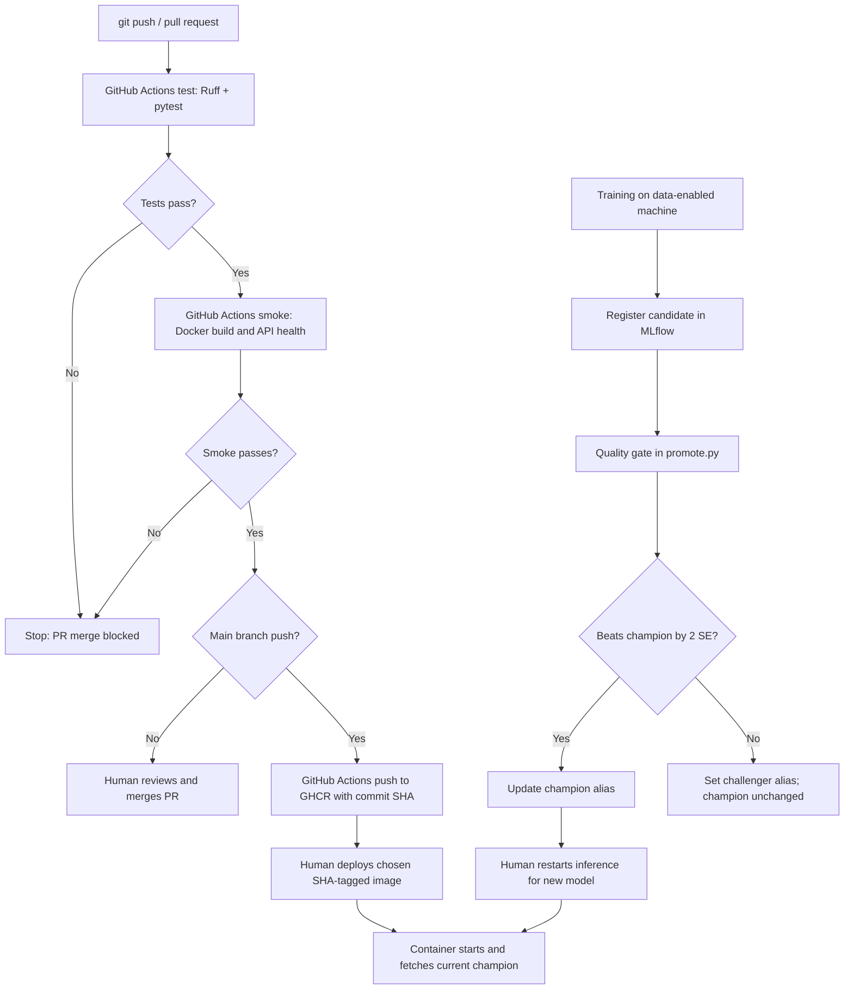

# Lab 5 — CI/CD with GitHub Actions

## Implementation and evidence

The repository includes a GitHub Actions workflow with `test`, `smoke`, and `push` jobs.
On push and pull request, `test` runs Ruff and pytest; if it passes, `smoke` builds
and health-checks the container with `SKIP_MODEL=1`. On `main` pushes only, `push`
authenticates with `GITHUB_TOKEN` and publishes the Docker image tagged with the
full Git commit SHA to `ghcr.io/ghadielbasha/mlops-lab-1`.

The CI/CD run for commit `0ceabcf` passed all three jobs in **5 min 51 sec**.
An earlier successful test+smoke run (`a9dec6b`) completed in **2 min 5 sec**.
These end-to-end durations are *not directly comparable*: the second run also
published a container image. The uv cache can accelerate dependency retrieval;
the Docker image publishing work adds time. A same-workload empty-commit rerun
should be timed separately if required for a controlled comparison.

Local data contract: the raw mini dataset contained **43 cross-split duplicate
groups**. A separate cleaned copy was created and validated; all five checks passed.
Copying one image from training into evaluation intentionally caused the
cross-split hash check to fail with exit code 1. The probe was removed.

A protected `main` branch requires pull requests and successful `test` and `smoke`
checks. Pull request #1 initially failed and could not be merged; after fixing the
intentional assertion, all required checks passed and PR #1 was merged.

## Q1 — Why not load the real model in a unit test?

That would make the tests depend on the MLflow server being reachable and on model
artifacts existing in its registry. Network outages, absent credentials, slow
model downloads, and memory/CPU limitations could all make a correct API fail.
The tests use `SKIP_MODEL=1` and a fake model instead.

## Q2 — What does the fake-model API test prove?

It proves that the API can accept an image, apply preprocessing, invoke a model,
and return a valid JSON response containing a class label and confidence value.
It does not prove that the trained ResNet18 weights are accurate or that the MLflow
server is available in production. The fake scores are treated as logits and
passed through softmax, so 0.90 is not necessarily the final JSON confidence.

## Q3 — Which check catches a duplicate, and why is it dangerous?

MD5 hashes of file contents detect images repeated across dataset splits, even if
they have different filenames. A duplicate between training and evaluation leaks
answers from training into the test and can silently inflate reported accuracy.
A corrupt image usually raises an obvious error; leakage can go unnoticed.

## Q4 — Where can validation run when CI has no DVC data?

Run `validate_data.py` (1) after `dvc pull` / dataset preparation in a
data-enabled training job or machine, and (2) immediately before any training
or model promotion on a machine that has the processed dataset. The lightweight
GitHub cloud runner cannot validate data it cannot access.

## Q5 — What does `needs: test` do?

It prevents the `smoke` job from running when unit tests or Ruff fail. Without
`needs`, the two jobs could run concurrently, wasting work and producing an image
from code that has failed the unit-test quality gate.

## Q6 — Timing and repeat-run caching

The successful test+smoke run took **2 min 5 sec**. The later full CI/CD run
including registry publishing took **5 min 51 sec**. The jobs had different
workloads, so their total durations cannot be used to quantify cache benefits.
The `setup-uv` cache avoids redownloading cached packages on later identical
runs. Run an empty commit on the feature branch after CI completes to compare
the same `test` and `smoke` jobs accurately; record those timings from Actions.

## Q7 — Why a SHA tag rather than `latest`?

A commit SHA identifies the exact code revision used to build an image and makes
rollbacks auditable. If machine A pulls `latest` on Monday and machine B pulls
`latest` after a new release on Tuesday, they can run different code under the
same tag. An immutable SHA avoids that ambiguity.

## Q8 — Why limit GitHub token permissions?

The `push` job requests `contents: read` and `packages: write` only. A compromised
step given broad permissions could modify repository content, publish forged
releases, or alter workflow files. Least-privilege permissions minimize damage.

## Q9 — What did the branch-protection experiment show?

PR #1 showed failing required `test` checks and skipped `smoke` checks; the
merge button was disabled. After correcting the assertion, both checks passed
for push and pull_request runs, and the merge button became available. The PR
was merged. This enforces shared, repeatable checks rather than relying on each
developer to remember to test locally.

## Q10 — Model quality gate and outcomes

The gate uses champion test accuracy `p` and evaluation image count `n`:

`SE = sqrt(p * (1 - p) / n)`; promotion requires `accuracy_candidate >= p + 2*SE`.

Two new candidate *training runs* used the leakage-free mini dataset. The first
used a very small learning rate; the second used the previous best learning rate.
Actual MLflow results:

| Candidate model version | Candidate accuracy | Champion accuracy | 2 × SE (percentage points) | Decision |
| --- | ---: | ---: | ---: | --- |
| 3 | 0.1058 | 0.6369 | 2.91 pp | challenger |
| 4 | 0.6177 | 0.6369 | 2.91 pp | challenger |

The script writes the decision, accuracies, threshold, test-set size, and previous
champion version as tags on each candidate version. Insufficient candidates get
the `challenger` alias; only candidates clearing the threshold become `champion`.
Note that the historical champion was evaluated on the earlier mini dataset;
for a rigorous model comparison, all candidates should be reevaluated on exactly
the same held-out clean test set.

## Q11 — How could promotion run automatically?

Option A: run `promote.py` as the final step of an on-premises or self-hosted
training pipeline with network access to the local MLflow server. Option B: use
an externally accessible hosted MLflow tracking server (e.g., DagsHub) and
trigger promotion from a protected CI workflow using scoped credentials.
Never expose a local MLflow instance publicly without authentication.

## Q12 — Pipeline diagram and release boundaries



Automatic: test, smoke, SHA-tagged image publishing on `main`, quality-gate
*decision when the local script is invoked*. Human: PR merge and image deployment,
starting candidate training and promotion script, and reloading running inference.
**Code version** is chosen by the deployed Docker image SHA. **Model version** is
chosen by the MLflow registry `champion` alias when inference starts.

## Commands

```bash
uv run ruff check src tests
uv run pytest -q
uv run python src/food11/validate_data.py data/food11_processed_mini_clean
uv run python src/food11/promote.py --version <candidate-version>
```

The clean dataset and trained model artifacts live locally and are **not**
included in the Git repository; the CI tests use the small fixture image.

## Q6 follow-up — controlled repeat-run measurements

The code and workflow contents were **identical** in two consecutive empty commits on the same feature branch. They therefore ran the same `test` and `smoke` workload (GHCR publishing is skipped off `main`).

| CI run | Commit | Whole-run seconds | `test` seconds | `smoke` seconds | Result |
|---|---|---:|---:|---:|---|
| [Repeat 1](https://github.com/ghadielbasha/mlops-lab-1/actions/runs/43770799806) | `07b34b13c` | 129.0 | 21.0 | 101.0 | success |
| [Repeat 2](https://github.com/ghadielbasha/mlops-lab-1/actions/runs/43771053166) | `44e8e4c7c` | 128.0 | 21.0 | 99.0 | success |

`test` job duration changed by +0.0 seconds (second minus first). Cache benefit is not guaranteed; runner provisioning, networking and scheduling also affect times.
